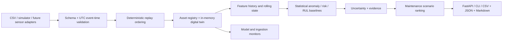

# V.O.I.D.E. 2.0 Architecture

## Scope
V.O.I.D.E. 2.0 extends the existing V.O.I.D.E. 1.x telemetry audit and Flutter engineering console. The new Python package is isolated under `voide2/`; no 1.x paths, data or persisted state are migrated automatically.

## Data path

## Domain model
- Asset identity is stable and unique per physical or simulated unit.
- Sensor contracts explicitly declare engineering units, plausible bounds and nominal sampling interval. Bounds in the synthetic chiller profile are illustrative validation ranges, not control or safety limits.
- Every telemetry event has an asset ID, timezone-aware event-time, event ID, source, sequence and named sensor values.
- Missing values are retained as nulls and counted. Non-finite values, unknown sensors and naive timestamps are rejected. Out-of-range numeric values receive quality flags.
- Event-time order is deterministic: timestamp, sequence, event ID. Late events must be reordered before state application; a live adapter will need a bounded-lateness/watermark policy.

## Prediction boundary
The current MVP uses transparent statistical proxies and a persistence comparator. RUL is trend extrapolation on a documented health proxy, with heuristic uncertainty; failure probability is an uncalibrated score. These are engineering baselines, not learned or calibrated prognostics. No control actions are executed.

## Persistence and deployment choices
The first slice is CPU-first, file-based and in-memory to keep setup small and reproducible. PostgreSQL/TimescaleDB, MLflow and Prometheus are next-stage adapters; this branch does not claim a durable timeseries database or production monitoring stack. SQLite from V.O.I.D.E. 1.x remains untouched.

## Rejected for MVP
- A row-random split: leaks same-asset and future operating context.
- A single opaque predictive model: no representative labelled failure corpus is currently included.
- Immediate TimescaleDB / MLflow / PyTorch deployment: adds operational overhead before the end-to-end semantics have been validated.
